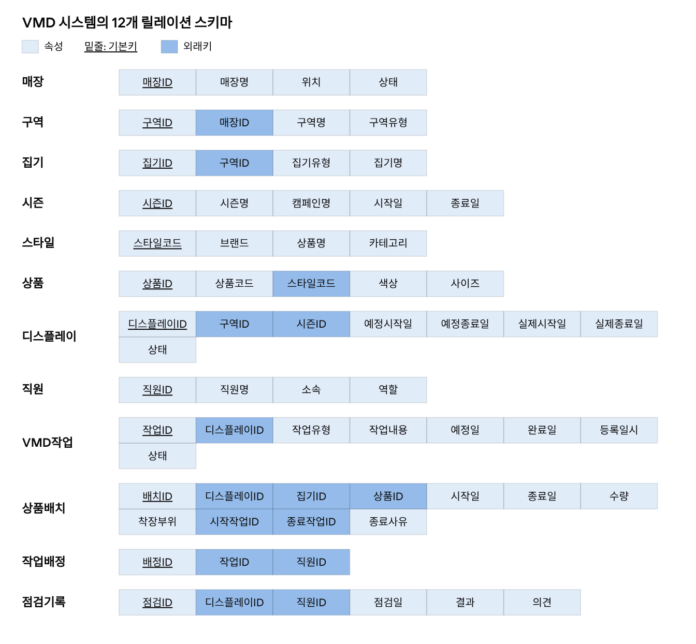

# 릴레이션 스키마

상태: **초안** (SQL 구현 전). 데이터 타입과 값 목록은 다음 단계에서 정한다.

| 릴레이션 | 속성 | 기본키 | 외래키 |
| --- | --- | --- | --- |
| 매장 | 매장ID, 매장명, 위치, 상태 | 매장ID | 없음 |
| 구역 | 구역ID, 매장ID, 구역명, 구역유형 | 구역ID | 매장ID → 매장 |
| 집기 | 집기ID, 구역ID, 집기유형, 집기명 | 집기ID | 구역ID → 구역 |
| 시즌 | 시즌ID, 시즌명, 캠페인명, 시작일, 종료일 | 시즌ID | 없음 |
| 스타일 | 스타일코드, 브랜드, 상품명, 카테고리 | 스타일코드 | 없음 |
| 상품 | 상품ID, 상품코드, 스타일코드, 색상, 사이즈 | 상품ID | 스타일코드 → 스타일 |
| 디스플레이 | 디스플레이ID, 구역ID, 시즌ID, 예정시작일, 예정종료일, 실제시작일, 실제종료일, 상태 | 디스플레이ID | 구역ID → 구역, 시즌ID → 시즌 |
| 직원 | 직원ID, 직원명, 소속, 역할 | 직원ID | 없음 |
| VMD작업 | 작업ID, 디스플레이ID, 작업유형, 작업내용, 예정일, 완료일, 등록일시, 상태 | 작업ID | 디스플레이ID → 디스플레이 |
| 상품배치 | 배치ID, 디스플레이ID, 집기ID, 상품ID, 시작일, 종료일, 수량, 착장부위, 시작작업ID, 종료작업ID, 종료사유 | 배치ID | 디스플레이ID → 디스플레이, 집기ID → 집기, 상품ID → 상품, 시작작업ID → VMD작업, 종료작업ID → VMD작업 |
| 작업배정 | 배정ID, 작업ID, 직원ID | 배정ID | 작업ID → VMD작업, 직원ID → 직원 |
| 점검기록 | 점검ID, 디스플레이ID, 직원ID, 점검일, 결과, 의견 | 점검ID | 디스플레이ID → 디스플레이, 직원ID → 직원 |

추가 후보키는 상품의 상품코드와 (스타일코드, 색상, 사이즈), 작업배정의 (작업ID, 직원ID)다. 복합 외래키를 사용하면 VMD작업의 (작업ID, 디스플레이ID)에도 UNIQUE 제약이 필요하다.

스타일코드가 브랜드, 상품명, 카테고리를 결정하므로 상품에서 분리했다. 분리하지 않으면 상품ID → 스타일코드 → 브랜드의 이행적 함수 종속이 생긴다.

직원의 소속 표현, 착장부위 값, 작업과 디스플레이의 상태 값은 아직 확정하지 않았다.
